<!--
**samyrjob/samyrjob** is a ✨ _special_ ✨ repository because its `README.md` (this file) appears on your GitHub profile.

-->
# Samy Rjob
Hello! I'm Samy 👨‍💻 — a French AI & full-stack engineer based in Paris, building software since 2022. I build backends, real-time systems and AI products that run in production.

## What I'm building

🎮 **[Futura](https://futura-game.com)** — a multiplayer virtual world, live since November 2026, that I designed, built and operate solo. About 100 LLM-driven inhabitants remember, plan, talk with players and trade. Java/Spring Boot backend, real-time game server, Angular front end, cryptographically signed Java desktop client with a Go launcher.

🎬 **[LudicoAI](https://ludicoai.com)** — learn English through real films: tap any word to see what it means in that scene and hear it in other accents. Android and desktop, Google Play launch in progress.

🤖 **[2YM Chatbot](https://uoc2ndyearbot.site/)** — a production RAG assistant used by real university cohorts for my MSc at the University of Chester. It answers in 9.4 seconds median, versus a two-day staff wait, and only when confident.

🛠️ **[Piskel MCP Server](https://github.com/samyrjob/piskel-mcp-server)** — open-source, LLM-drivable pixel-art engine with ~50 MCP tools.

## Before

🤝 **[Elite Talents](https://elitetalents.fr/)** — freelance Backend Engineer of a live recruitment platform (Nov 2025 – Apr 2026). I built its 165-endpoint Next.js API, the Postgres schema and the security model (RLS on every table).

🎓 **[Trainee+](https://github.com/samyrjob/Traineeplus)** — founder of an internship platform in Rails 7 that connected 130 students with 16 companies across five European tech hubs.

## Stack

☕ Java · 🐹 Go · 📘 TypeScript · 🐍 Python · 💎 Ruby · 🗄️ SQL

Spring Boot · Angular · Next.js · PostgreSQL · MySQL · Redis · Kafka · Docker · AWS · Ollama · OpenAI

## Links

📁 [Portfolio](https://samyrjob.is-a.dev) · 💼 [LinkedIn](https://www.linkedin.com/in/samy-rjob-800315176/) · 📄 [CV](https://samyrjob.github.io/portfolio/Samy_Rjob_CV_AI_Engineer.pdf)

 

## 🤝 Let's Connect

  
  

 
 

 

## 🔨 Languages and Tools:
  
  
  
  
  
  
  
  
  
  
  
  
  
  
  
  
  
  
  
  
  

 
 

## 🐍 Contributions

<picture>
  <source media="(prefers-color-scheme: dark)" srcset="https://raw.githubusercontent.com/samyrjob/samyrjob/output/github-snake-dark.svg" />
  <source media="(prefers-color-scheme: light)" srcset="https://raw.githubusercontent.com/samyrjob/samyrjob/output/github-snake.svg" />
  
</picture>

## 📊 Github Stats

  

  

 

 
 

## 📌 Recent Activity

<!--START_SECTION:activity-->
1. 🎉 Merged PR [#7](https://github.com/yafeiaa/piskel-mcp-server/pull/7) in [yafeiaa/piskel-mcp-server](https://github.com/yafeiaa/piskel-mcp-server)
2. ❗ Opened issue [#1220](https://github.com/konsoletyper/teavm/issues/1220) in [konsoletyper/teavm](https://github.com/konsoletyper/teavm)
3. 🎉 Merged PR [#1](https://github.com/samyrjob/teavm/pull/1) in [samyrjob/teavm](https://github.com/samyrjob/teavm)
4. 💪 Opened PR [#1](https://github.com/samyrjob/teavm/pull/1) in [samyrjob/teavm](https://github.com/samyrjob/teavm)
5. 🗣 Commented on [#7](https://github.com/yafeiaa/piskel-mcp-server/pull/7#issuecomment-5079428031) in [yafeiaa/piskel-mcp-server](https://github.com/yafeiaa/piskel-mcp-server)
<!--END_SECTION:activity-->
